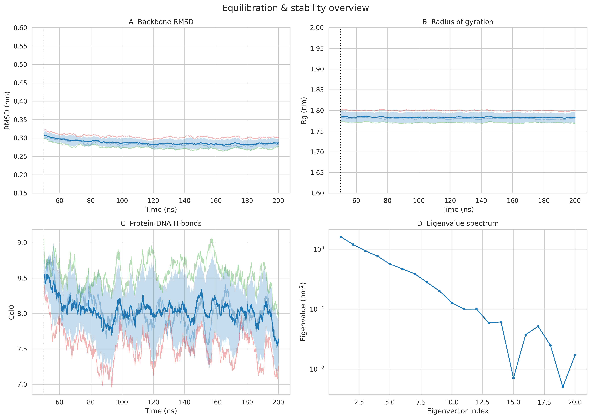
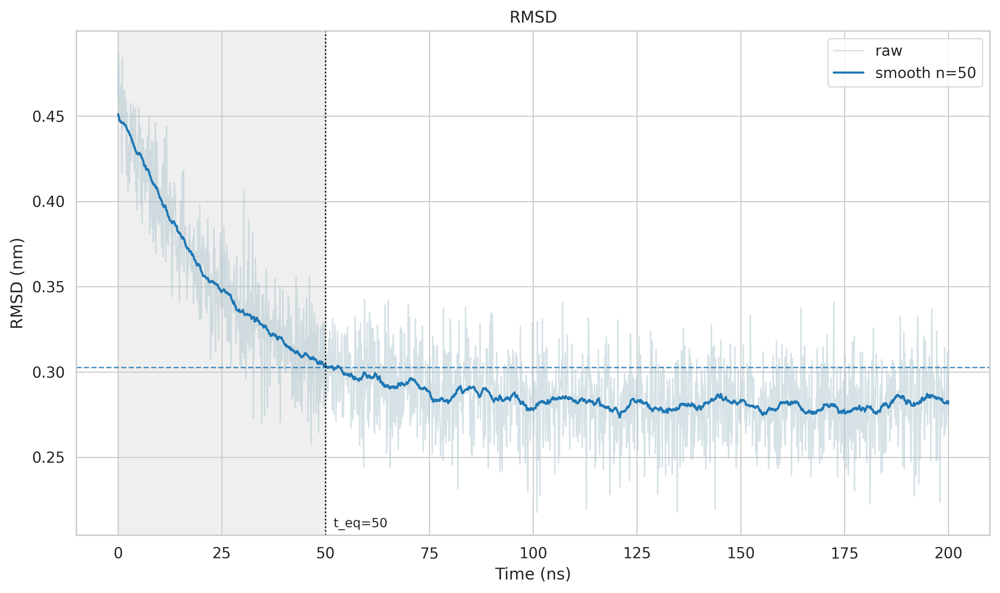
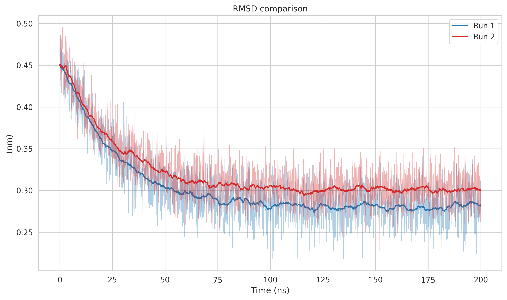
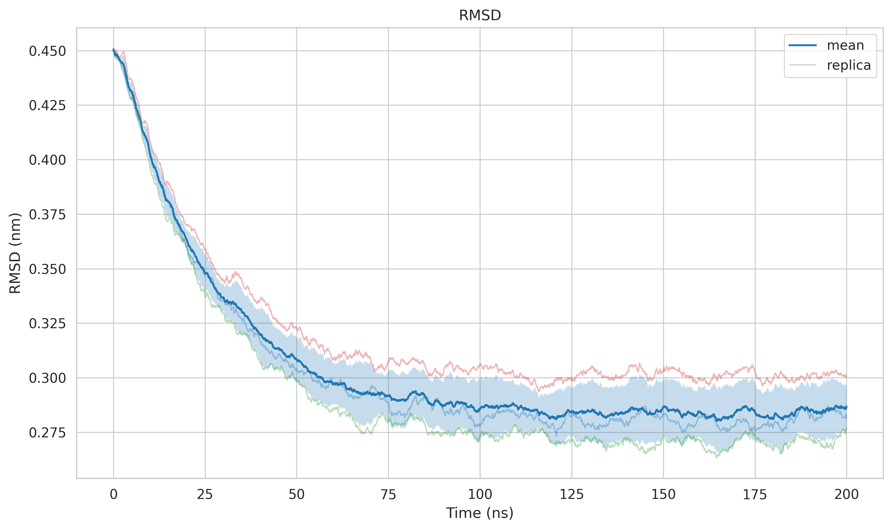
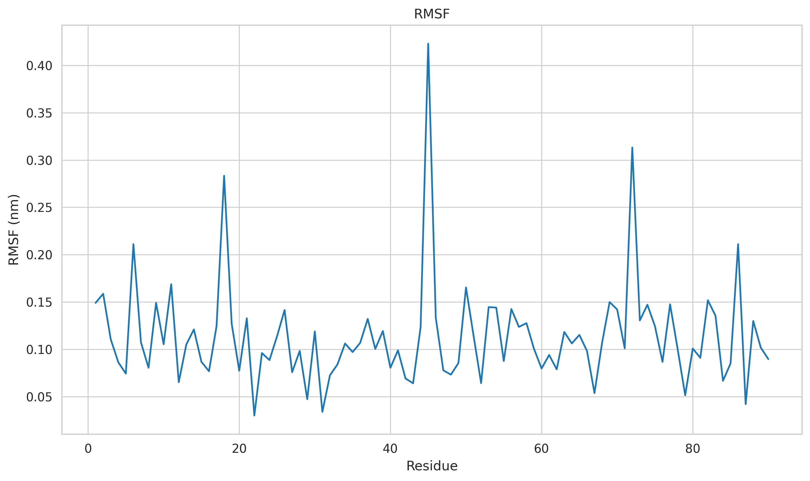
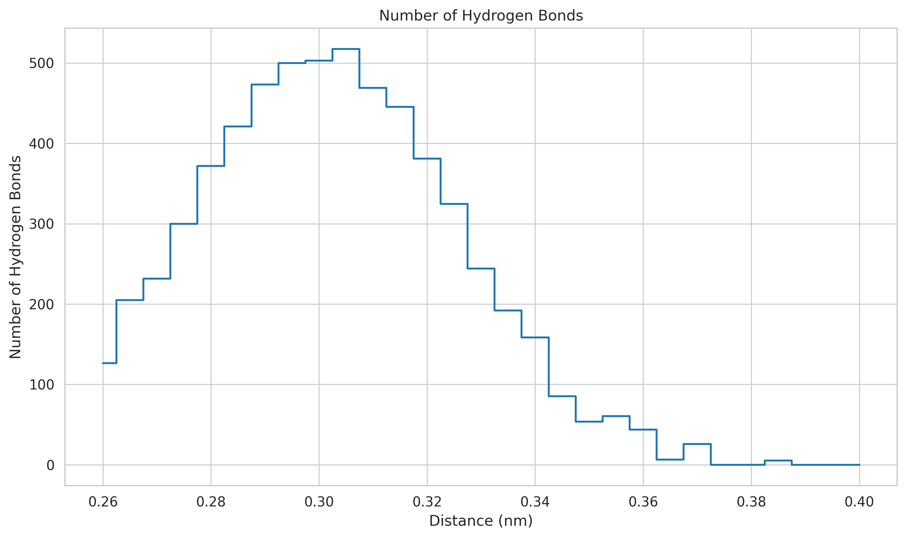
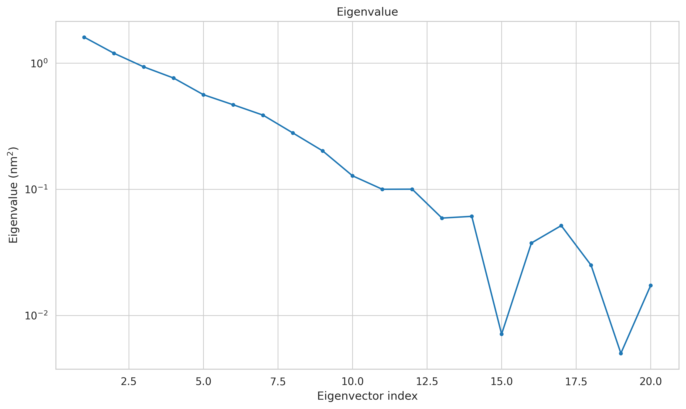
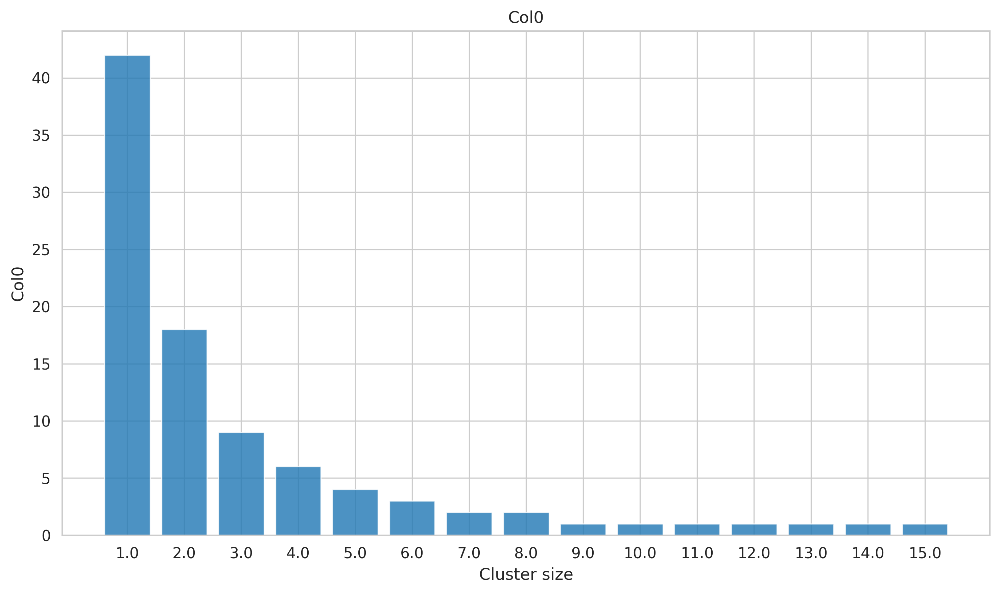
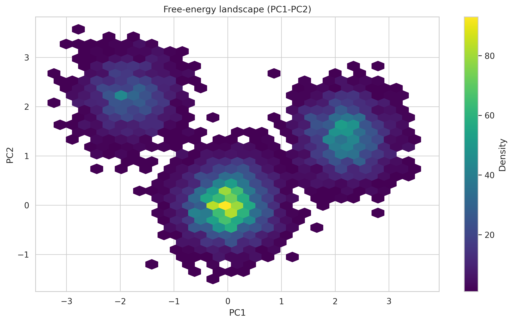

<div align="center">


# gmxplot

**A GROMACS XVG visualization & statistics tool with type-aware semantics.**

<p>
Auto-detect, plot, compare, aggregate, and summarize GROMACS <code>.xvg</code>
output from the command line. Every file is classified by <em>what the data
is</em> (<code>family</code>) and <em>how it should be rendered and analyzed</em>
(<code>kind</code>), so histograms are never smoothed and time series get
physical units, equilibrated windows, and rigorous error bars.
</p>



[](https://www.gnu.org/licenses/gpl-3.0)
[](#installation)
[](http://makeapullrequest.com)
[](#-commands)
[](#-concepts-family-vs-kind)

<p>
  <a href="#-installation">Installation</a> ·
  <a href="#-quick-start">Quick Start</a> ·
  <a href="#-commands">Commands</a> ·
  <a href="#-plot-kinds">Plot Kinds</a> ·
  <a href="#-shared-style-options">Style Options</a> ·
  <a href="#-statistics">Statistics</a> ·
  <a href="#-reproduce-the-examples">Examples</a>
</p>

</div>

> **If this project helps you, please consider giving it a Star ⭐. Thank you!**

---

## Index

- [gmxplot](#gmxplot)
  - [📖 Overview](#-overview)
  - [🚀 Features](#-features)
  - [📦 Installation](#-installation)
  - [⚡ Quick Start](#-quick-start)
  - [🧠 Concepts: family vs kind](#-concepts-family-vs-kind)
  - [🛠️ Commands](#️-commands)
    - [`detect`](#-detect-file)
    - [`plot`](#-plot-file)
    - [`compare` / `multi-compare`](#-compare-file1-file2--multi-compare-files)
    - [`replicas`](#-replicas-files)
    - [`stats`](#-stats-files)
    - [`dashboard`](#-dashboard-manifest)
    - [`batch`](#-batch-input_dir)
  - [🎨 Plot Kinds](#-plot-kinds)
  - [🕐 Time Axis & Windowing](#-time-axis--windowing)
  - [🌊 Smoothing](#-smoothing)
  - [📊 Statistics](#-statistics)
  - [🧬 Replica Aggregation](#-replica-aggregation)
  - [🧩 Dashboard Manifest](#-dashboard-manifest)
  - [🎛️ Shared Style Options](#️-shared-style-options)
  - [🔁 Reproduce the Examples](#-reproduce-the-examples)
  - [🏗️ Architecture](#️-architecture)
  - [📄 License](#-license)

---

## 📖 Overview

`gmxplot` reads GROMACS XVG files, classifies each one by *what the data is*
(`family`) and *how it should be rendered and analyzed* (`kind`), then produces
publication-ready matplotlib figures and rigorous statistics. It normalizes
physical time axes, applies configurable windows and smoothing, aggregates
independent replicas into a mean±band figure, and assembles heterogeneous XVG
files into a single dashboard from a JSON manifest.

The classification is what makes the tool trustworthy: a **hydrogen-bond
distance histogram** is drawn as a step plot with *no* rolling average, an
**eigenvalue spectrum** is a marker plot (optionally log-scaled), and **cluster
sizes** are bars — while a **time series** (RMSD, Rg, energy, …) gets a rolling
average and drift statistics. Nothing is smoothed by accident.

## 🚀 Features

- **Two-level classification** — `family` (energy, rmsd, hbond_dist, …) is
  decoupled from `kind` (timeseries, histogram, spectrum, bar, profile, pca,
  scatter, xy). Rolling averages and drift statistics apply *only* to
  `timeseries`.
- **Physical time axes** — `Time (ps|ns|us|fs)` is detected and normalized to ns;
  `--start/--end/--t-eq` and `--roll-window` are expressed in physical units.
- **Configurable windows** — statistics are computed on a `[start, end]` window;
  `--plot-full` shows the full trajectory with the out-of-window region shaded.
- **Rigorous statistics** — naive and block-averaged SEM, half-window drift test,
  count-weighted histogram statistics, and correct PCA (both PCs analyzed).
- **Replica aggregation** — faint per-replica lines + mean with an SD/SEM band,
  with union/first/intersection alignment and long/summary CSV export.
- **JSON dashboard** — assemble any mix of single-file and replica panels into one
  figure with shared time axes, `t_eq` lines, and panel labels.
- **GROMACS escape codes** — xmgrace `\S`, `\s`, `\f{}` converted to mathtext.
- **Multiple output formats** — PNG (default), PDF, SVG, EPS, JPG, TIFF.

---

## 📦 Installation

```bash
pip install gmxplot
```

or

```bash
git clone https://github.com/MaybeBio/gmxplot.git
cd gmxplot
pip install -e .
```

Requirements: Python ≥ 3.10, numpy, pandas, matplotlib, seaborn, typer, rich.

---

## ⚡ Quick Start

```bash
# Inspect how a file is classified
gmxplot detect rmsd.xvg

# Plot with automatic detection, 1 ns rolling window
gmxplot plot rmsd.xvg -o rmsd.png --roll-window 1.0

# Statistics on the equilibrated segment, 10 ps blocks
gmxplot stats rmsd.xvg --start 100 --end 200 --block-time 0.01

# Compare two runs
gmxplot compare rep1/rmsd.xvg rep2/rmsd.xvg -l1 WT -l2 Mutant

# Aggregate three replicas into a mean±SD band
gmxplot replicas rep1/rmsd.xvg rep2/rmsd.xvg rep3/rmsd.xvg \
  --labels r1,r2,r3 --band sd --summary-csv rmsd_summary.csv

# Render a dashboard from a manifest
gmxplot dashboard manifest.json -o overview.pdf --stats-csv panel_stats.csv
```

---

## 🧠 Concepts: family vs kind

Two orthogonal ideas replace the old single `plot_type`:

- **`family`** — the *semantic content* of the file: what the numbers mean.
- **`kind`** — the *rendering / statistics semantics*: how it should be drawn and
  what statistics are valid.

| `family` | meaning |
|---|---|
| `energy` | energies, temperature, pressure, density (multi-column) |
| `rmsd` / `rmsf` | deviation / per-residue fluctuation |
| `gyration` | radius of gyration (`Rg` and components) |
| `sasa` | solvent-accessible surface (time series or per-residue) |
| `pca` | principal-component projection |
| `hbond_num` / `hbond_dist` | hydrogen-bond count / distance distribution |
| `mindist` / `contacts` | minimum distance / contact count |
| `eigenvalue` | covariance eigenvalue spectrum |
| `cluster_size` | cluster-size distribution |
| `dssp` | secondary-structure content |
| `generic` / `unknown` | anything else |

| `kind` | meaning | smoothing | drift |
|------|---------|-----------|-------|
| `timeseries` | ordered time series | yes | yes |
| `profile` | per-residue / per-atom profile | no | no |
| `histogram` | bin coordinate + counts | no | no (weighted x-stats) |
| `spectrum` | eigenvalue / index vs intensity | no | no |
| `bar` | discrete categories / cluster sizes | no | no |
| `pca` | PC1–PC2 scatter / hexbin | no | no |
| `scatter` | unordered x–y scatter | no | no |
| `xy` | ordered non-time line | no | no |

**Smoothing is only offered to `timeseries`**; requesting it on any other kind is
silently ignored (those kinds never smooth).

Overrides and precedence: `--kind` > `--type`-implied kind > automatic detection.
`--type` sets `family`, `--kind` sets `kind`. Both appear in `gmxplot detect`.

---

## 🛠️ Commands

| command | purpose |
|---|---|
| [`detect`](#-detect-file) | print family / kind / columns / units without plotting |
| [`plot`](#-plot-file) | render one file with automatic detection |
| [`compare`](#-compare-file1-file2--multi-compare-files) | overlay two files |
| [`multi-compare`](#-compare-file1-file2--multi-compare-files) | overlay 3+ files |
| [`replicas`](#-replicas-files) | aggregate 2+ replicas into mean ± band |
| [`stats`](#-stats-files) | write a statistics CSV |
| [`dashboard`](#-dashboard-manifest) | render a multi-panel JSON manifest |
| [`batch`](#-batch-input_dir) | plot every XVG in a directory |

### 🔍 `detect FILE`

Print the resolved family, kind, columns, time unit, and primary y columns.

```
gmxplot detect rmsd.xvg
  File: rmsd.xvg
  Family: rmsd
  Kind:   timeseries
  X column: Time   X is time: True   Time unit: ns
  Y columns: RMSD
```

### 📈 `plot FILE`

Render a single XVG file.

**Key options**

- `-o/--output` — output path (PNG, PDF, SVG, EPS, JPG, TIFF).
- `--kind`, `--type` — override rendering kind / data family.
- `--x-col`, `--y-col` (repeatable), `--all-cols` — column selection.
- `--start`, `--end`, `--t-eq`, `--plot-full` — statistics window + shading.
- `--time-unit {auto,ps,ns,us,fs}`, `--no-time-normalize`.
- `--roll-samples N` / `--roll-avg N` / `--roll-window T` / `--roll-fraction F` /
  `--no-roll` / `--no-raw`.
- `--mean`, `--std` — horizontal mean / ±std reference lines.
- `--csv PATH` — write the resolved windowed data (x + y columns).
- plus the [shared style options](#️-shared-style-options).

**Example** — RMSD with a 5 ns rolling window, an equilibration marker at 50 ns,
full trajectory shown with the pre-equilibration region shaded:

```bash
gmxplot plot examples/data/rmsd_r1.xvg \
  --roll-window 5 --t-eq 50 --plot-full --mean \
  -o figs/plot_timeseries.png
```



### 🆚 `compare FILE1 FILE2` / `multi-compare FILES...`

Overlay two (`compare`) or three-plus (`multi-compare`) files. Accepts the same
dataset options as `plot`; `--label1/--label2` (`compare`) or `--labels`
(`multi-compare`) set trace labels. Colors cycle the default tab10 palette, or a
custom one via `--palette`.

```bash
gmxplot compare examples/data/rmsd_r1.xvg examples/data/rmsd_r2.xvg \
  -l1 "Run 1" -l2 "Run 2" --roll-window 5 -o figs/compare.png
```



### 🧬 `replicas FILES...`

Aggregate 2+ replicas into faint per-replica lines + a mean with an SD/SEM band.

**Key options**

- `--labels` — comma-separated or repeated labels.
- `--align {union,first,intersection}` — x-axis alignment (default `union`).
- `--band {sd,sem,none}` — band type (default `sd`).
- `--min-replicas N` — suppress the mean where fewer than N replicas overlap
  (default 2).
- `--csv` — long-format tidy CSV (`x, series, replica, value`).
- `--summary-csv` — per-replica window statistics + cross-replica mean±SD.

```bash
gmxplot replicas examples/data/rmsd_r1.xvg \
  examples/data/rmsd_r2.xvg examples/data/rmsd_r3.xvg \
  --labels r1,r2,r3 --band sd --roll-window 5 -o figs/replicas.png
```



### 📊 `stats FILES...`

Write a statistics CSV (also printed as a Rich table).

**Key options**

- `--start/--end`, `--time-unit` — the analysis window.
- `--block-size N` or `--block-time T` — block-averaging size.
- `--flat-threshold F` — drift flag threshold (default 2.0).
- `--ignore-series REGEX` (repeatable) — skip matching series (e.g. `RgX|RgY|RgZ`).
- `-o/--out` — output CSV path.

```bash
gmxplot stats examples/data/rmsd_r1.xvg --start 50 --block-time 5
```

See [Statistics](#-statistics) for the exact columns and definitions.

### 🧩 `dashboard MANIFEST`

Render a multi-panel figure from a JSON manifest. See the full
[manifest schema](#-dashboard-manifest).

```bash
gmxplot dashboard examples/dashboard.json -o figs/dashboard.png
```

**Key options**: `-o`, `--dpi`, `--figsize`, `--cols`, `--sharex/--no-sharex`,
`--strict`, `--stats-csv`, `--latex/--no-latex`.

### 📁 `batch INPUT_DIR`

Plot every XVG in a directory using the full `plot` pipeline.

**Key options**: `-o/--output-dir`, `--recursive`, `--pattern` (default `*.xvg`),
`--skip-errors`, `--roll-avg`, `--dpi`, `--ext`, `--stats/--no-stats`,
`--stats-file`, `--mean`, `--std`.

With `--recursive`, the relative directory structure under `INPUT_DIR` is
preserved in the output directory (so `sub/a.xvg` → `<out>/sub/a_plot.png`),
avoiding stem collisions across subdirectories.

```bash
gmxplot batch examples/data -o figs/batch --recursive --no-stats
```

---

## 🎨 Plot Kinds

Each kind gets its own primitive. Sample figures below were rendered from the
synthetic data in `examples/data/`.

**`timeseries`** — ordered time series; raw (faint) + rolling average, mean/±std
lines, `t_eq` marker, window shading.

**`profile`** — per-residue / per-atom line (RMSF, per-residue SASA). No smoothing.

```bash
gmxplot plot examples/data/rmsf.xvg -o figs/plot_profile.png
```



**`histogram`** — bin coordinate + counts as a step plot. No rolling; weighted
x-statistics only.

```bash
gmxplot plot examples/data/hbond_dist.xvg -o figs/plot_histogram.png
```



**`spectrum`** — eigenvalue / index vs intensity. No smoothing; `--ylog` is handy.

```bash
gmxplot plot examples/data/eigenvalue.xvg --ylog -o figs/plot_spectrum.png
```



**`bar`** — discrete categories / cluster sizes.

```bash
gmxplot plot examples/data/cluster_size.xvg -o figs/plot_bar.png
```



**`pca`** — PC1–PC2 projection as a hexbin density (or `--kind scatter`).

```bash
gmxplot plot examples/data/proj2d.xvg -o figs/plot_pca.png
```



---

## 🕐 Time Axis & Windowing

- The x axis is detected as time when its label contains `Time (...)` or the
  family is a time-series family. `--time-unit auto` converts to ns via
  `ps→1e-3`, `ns→1`, `us→1e3`, `fs→1e-6`; `--no-time-normalize` keeps the
  original unit.
- `--start`/`--end` trim **both** the plot and the statistics window.
- `--plot-full` keeps the full trajectory on the plot and shades the region
  outside the window; statistics still use `[start, end]`.
- `--t-eq` draws a vertical line; without an explicit `--start`, the statistics
  window starts at `t_eq` (plot full, analyze `[t_eq, end]`).

---

## 🌊 Smoothing

Only `timeseries` is smoothed. Window resolution order:

`--no-roll` > `--roll-samples` > `--roll-window` > `--roll-fraction` > auto.

The default is 1% of the x-span; `--roll-window` is converted to samples via the
median Δx. Samples are clamped to `[3, min(100, n//2)]`.

---

## 📊 Statistics

For a `timeseries` (NaN dropped pairwise):

- `n`, `mean`, `sd` (ddof=1), `sem = sd/√n`
- `block_size` (default `round(n**(1/3))`, override with `--block-size/--block-time`),
  `n_blocks = floor(n/block_size)`, `sem_block = SD(block means)/√n_blocks`
- `sem_used = max(sem, sem_block)`
- `mean_first_half` / `mean_second_half` split at the window midpoint
- `drift = mean_second − mean_first`
- `drift_over_sem = |drift| / √(sem1_used² + sem2_used²)` (plus a naive ratio)
- `flag = flat` if `drift_over_sem ≤ --flat-threshold` (default 2), else `DRIFT`
- `min/q10/q50/q90/max`

`profile`/`spectrum`/`bar`/`xy`/`scatter` output descriptive statistics only.
`histogram` adds count-weighted x statistics: `x_weighted_mean`,
`x_weighted_sd`, `x_weighted_median`, `x_mode`, `n_eff = (Σw)²/Σw²`,
`sem_weighted`. `pca` analyzes every PC column.

`--ignore-series REGEX` skips matching series (e.g. `RgX|RgY|RgZ`).

---

## 🧬 Replica Aggregation

- Each replica is time-normalized and windowed independently.
- `--align union` (default) uses the union of x points; `first` uses the first
  file's grid; `intersection` uses shared points. Values are `np.interp`-ed
  within each replica's support (NaN outside, no extrapolation).
- Smoothing (if any) is applied per replica *before* aggregation; the summary CSV
  always uses the raw windowed data.
- `--band sd` (default) fills mean±SD, `sem` fills mean±SEM, `none` draws only
  the mean. `--min-replicas` (default 2) suppresses the mean where too few
  replicas overlap.

---

## 🧩 Dashboard Manifest

```json
{
  "title": "Equilibration overview",
  "time_unit": "auto",
  "start": 0, "end": 200, "t_eq": 100,
  "cols": 2, "figsize": [14, 10], "sharex": true,
  "panels": [
    { "file": "rep1/rmsd.xvg", "title": "Backbone RMSD",
      "kind": "timeseries", "y_col": "RMSD", "ylim": [0, 0.6] },
    { "files": ["rep1/hbnum.xvg", "rep2/hbnum.xvg", "rep3/hbnum.xvg"],
      "labels": ["r1", "r2", "r3"], "title": "Interface H-bonds", "band": "sd" }
  ]
}
```

- Global keys (`title`, `time_unit`, `start`, `end`, `t_eq`, `cols`, `figsize`,
  `sharex`) are inherited by every panel and overridable per-panel.
- A panel has either `file` (single) or `files` + `labels` (replica).
- Panel keys: `kind`, `type`, `x_col`, `y_col`/`y_cols`, `all_cols`, `title`,
  `xlabel`, `ylabel`, `ylog`, `ylim`, `xlim`, `hline`, `vline`, `start`, `end`,
  `t_eq`, `roll_window`, `roll_samples`, `legend`, `band`, `align`, `min_replicas`.
- Multi-column panels are expanded into one sub-plot per y column so each axis
  carries a single self-consistent unit. `t_eq` lines and panel letters (A, B, C…)
  are drawn automatically; `sharex` applies only when every panel is a time axis.
- Unknown keys warn by default and error under `--strict`.

A complete, runnable example lives in
[`examples/dashboard.json`](examples/dashboard.json).

---

## 🎛️ Shared Style Options

Every plotting command shares one style parameter set:

| option | default | description |
|---|---|---|
| `--figsize "W H"` | `10 6` | figure size in inches |
| `--title` | (file title) | plot title |
| `--xlabel` / `--ylabel` | (axis label) | override axis labels |
| `--xlim "MIN MAX"` / `--ylim "MIN MAX"` | auto | axis limits |
| `--xlog/--no-xlog` | off | log x axis |
| `--ylog/--no-ylog` | off | log y axis |
| `--grid/--no-grid` | on | grid lines |
| `--legend/--no-legend` | on | show legend |
| `--legend-loc` | `best` | legend location |
| `--cmap` | `viridis` | colormap for PCA hexbins |
| `--palette` | tab10 | multi-series line colors (see below) |
| `--line-width` | `1.5` | smoothed / main line width |
| `--raw-alpha` | `0.5` | raw line opacity |
| `--hline` (repeatable) | — | horizontal reference line |
| `--vline` (repeatable) | — | vertical reference line |
| `--dpi` | `300` | output resolution |
| `--latex/--no-latex` | off | LaTeX text rendering |

**`--palette`** sets the multi-series line colors (used by `compare`,
`multi-compare`, and multi-column `xy`). It accepts:

- a comma-separated color list, cycled as needed — `--palette '#1f77b4,#d62728,green'`;
- a matplotlib colormap name — `--palette tab10`;
- a seaborn palette name — `--palette colorblind`.

---

## 🔁 Reproduce the Examples

All figures in this README are generated from synthetic data shipped in the repo:

```bash
python examples/generate_data.py     # (re)write examples/data/*.xvg
bash   examples/make_figures.sh      # render figs/*.png  (requires gmxplot)
```

The synthetic files carry genuine GROMACS-style headers, so they exercise the
full auto-detection path — including the kinds (histogram, spectrum, bar, pca)
that must *not* be smoothed.

---

## 🏗️ Architecture

```
gmxplot/
├── cli.py          # Typer CLI: 8 commands, lazy matplotlib backend
├── parser.py       # XVG parsing, family/kind detection, column naming, time unit
├── dataset.py      # Dataset/DatasetOptions: columns, time, window, rolling
├── plotting.py     # per-kind primitives + StyleOptions + palette
├── comparison.py   # multi-dataset overlay
├── replicas.py     # alignment + mean±SD band + CSV export
├── dashboard.py    # JSON manifest → multi-panel figure
├── stats.py        # SEM/block-SEM/drift/histogram-weighting + CSV
├── escape_codes.py # xmgrace → mathtext
└── config.py       # defaults (colors, rolling, block, thresholds)
```

Data flow: `parser.read_xvg` → `dataset.prepare_dataset` (resolve family/kind,
normalize time, apply window, resolve rolling) → `plotting.plot_dataset` /
`comparison.compare_datasets` / `replicas.replica_plot` / `dashboard.render_dashboard`
→ `stats.compute_dataset_stats`.

---

## 📄 License

GPL-3.0 — see [LICENSE](LICENSE).
